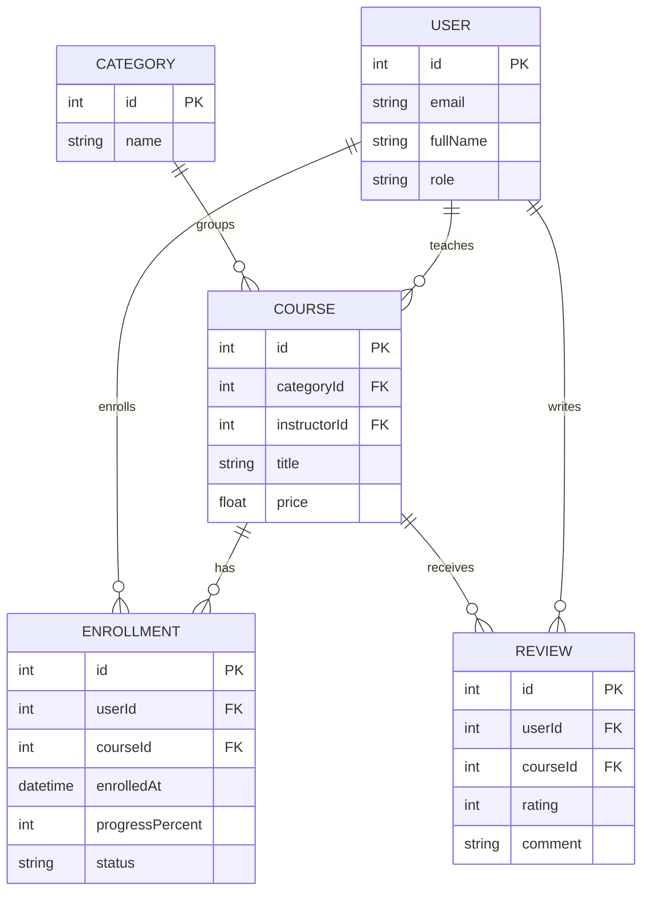

# Лабораторні роботи (Express + TypeScript)

Дисципліна «Технологія розробки Інтернет-застосунків», ХНТУ. Студент: Тихонов Вадим.

ЛР1 — HTTP-сервер і ER-діаграма, ЛР2 — REST API на мок-даних.

## Предметна область: платформа онлайн-курсів

Викладачі створюють курси по категоріях, студенти записуються на курси, проходять їх і залишають відгуки.

Сутності: `USER`, `CATEGORY`, `COURSE`, `ENROLLMENT`, `REVIEW`.

- `CATEGORY` 1:N `COURSE`
- `USER` (викладач) 1:N `COURSE`
- `USER` N:M `COURSE` через `ENROLLMENT` (там ще `enrolledAt`, `progressPercent`, `status`)
- `COURSE` 1:N `REVIEW`, `USER` 1:N `REVIEW`

## ER-діаграма



## Запуск

```bash
npm install
cp .env.example .env     # на Windows: copy .env.example .env
npm run dev
```

Перевірка: `GET http://localhost:3000/api/v1/health`

```json
{
  "status": "OK",
  "uptime": 3.14,
  "timestamp": "2026-10-27T01:00:00.000Z",
  "nodeVersion": "v22.x.x",
  "memoryUsage": { "rss": 0, "heapTotal": 0, "heapUsed": 0, "external": 0, "arrayBuffers": 0 }
}
```

## Запуск

```bash
npm install
copy .env.example .env
npm run dev
```

Сервер стартує на `http://localhost:3000`.

## API (ЛР2)

Дані лежать у масивах в пам'яті, база не використовується.

| Метод | Шлях | Що робить |
|-------|------|-----------|
| GET | `/api/v1/health` | стан сервера |
| GET | `/api/v1/courses` | усі курси |
| GET | `/api/v1/courses/:id` | курс за id (404, якщо нема) |
| GET | `/api/v1/categories` | усі категорії |
| GET | `/api/v1/categories/:id` | категорія за id (404, якщо нема) |

Колекція для Postman: `postman_collection_milestone1.json`.

## Структура

```
src/
  app.ts
  server.ts
  routes/
  controllers/
  services/
  middlewares/
  utils/
```
