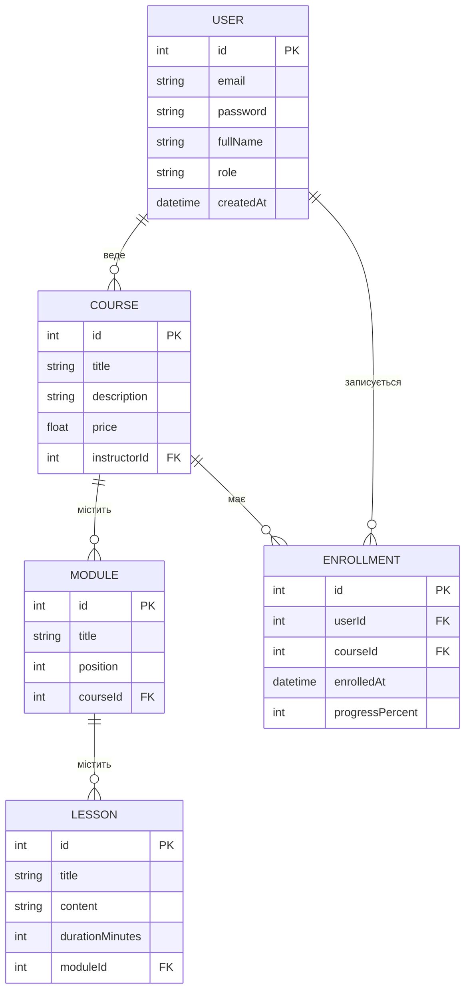

# Лабораторні роботи (Express + TypeScript + Prisma)

Дисципліна «Технологія розробки Інтернет-застосунків», ХНТУ. Студент: Тихонов Вадим.

ЛР1 — HTTP-сервер, ЛР2 — REST API на мок-даних, ЛР3 — PostgreSQL і Prisma, ЛР4 — репозиторії, Zod, пагінація, транзакції, ЛР5 — bcrypt, JWT, RBAC, ЛР6 — клієнт і E2E-тести.

## Предметна область: платформа онлайн-курсів

Викладачі ведуть курси, у курсів є модулі, а в модулів — уроки. Студенти записуються на курси.

Моделі: `User`, `Course`, `Module`, `Lesson`, `Enrollment`, `Order`, `OrderItem`.

- `User` 1:N `Course` (викладач веде курси)
- `Course` 1:N `Module`, `Module` 1:N `Lesson`
- `User` N:M `Course` через `Enrollment` (там `enrolledAt` і `progressPercent`)

Ролі користувача: `USER` (студент), `MANAGER` (викладач), `ADMIN` (адмін платформи).



## Запуск

Потрібні Node.js 22 і PostgreSQL.

```bash
npm install
copy .env.example .env
npx prisma migrate dev
npx prisma db seed
npm run dev
```

Рядок підключення до БД лежить у `.env` (`DATABASE_URL`), там же `JWT_SECRET`.

## Архітектура

`routes` -> `controllers` -> `services` -> `repositories` -> Prisma. Клієнт Prisma викликається лише в `repositories`, у контролерах і роутах його немає. Валідація тіла й query робиться через Zod-схеми з `src/dto` та middleware `validateBody` і `validateQuery`.

## API

| Метод | Шлях | Що робить |
|-------|------|-----------|
| GET | `/api/v1/health` | стан сервера |
| GET | `/api/v1/courses?page=1&limit=10` | курси з пагінацією (`items`, `total`, `page`, `totalPages`, `hasNextPage`) |
| GET | `/api/v1/courses/:id` | курс за id |
| POST | `/api/v1/auth/register` | реєстрація, пароль хешується bcrypt (10 раундів), роль USER |
| POST | `/api/v1/auth/login` | вхід, повертає Access JWT на 15 хвилин |
| GET | `/api/v1/auth/me` | дані з токена (authGuard) |
| POST | `/api/v1/courses` | створити курс, тільки ADMIN |
| DELETE | `/api/v1/courses/:id` | видалити курс, тільки ADMIN |
| POST | `/api/v1/orders` | замовлення від імені користувача з токена, одна транзакція |
| GET | `/api/v1/orders/:id` | замовлення, USER бачить лише свої |
| PATCH | `/api/v1/orders/:id/status` | зміна статусу, MANAGER або ADMIN |

Ролі: `USER`, `MANAGER`, `ADMIN`. Тестові акаунти з seed мають пароль `Password123`: `admin@khntu.edu.ua` (ADMIN), `teacher@example.com` (MANAGER), `ivan@example.com` (USER).

## Клієнт і тести

Сторінка `public/index.html` роздається через `express.static` і відкривається на `http://localhost:3000`. Вона вміє входити, показувати курси з пагінацією, створювати курс (ADMIN) і завершувати сесію.

E2E-колекція Postman: `postman_collection_e2e.json`. З командного рядка: `npm run e2e`.

## Структура

```
prisma/        schema.prisma, seed.ts, migrations/
src/
  app.ts, server.ts
  routes/ controllers/ services/ repositories/
  dto/ middlewares/ lib/ utils/
scripts/       перевірки API
public/        клієнтська сторінка
```
