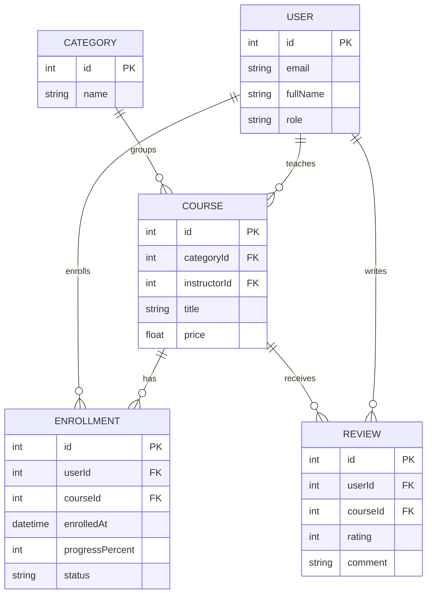

# khntu-web-monolith-tykhonov

Лабораторна робота №1 з дисципліни «Технологія розробки Інтернет-застосунків» (ХНТУ).
Студент: Тихонов Вадим.

Тема: початкова архітектура проєкту, ER-діаграма сутностей та налаштування HTTP-сервера.

## Предметна область: платформа онлайн-курсів

Система дозволяє викладачам публікувати курси, згруповані за категоріями, а студентам — записуватися на них,
відстежувати прогрес навчання та залишати відгуки.

| Сутність     | Призначення                                                                    |
| ------------ | ------------------------------------------------------------------------------ |
| `USER`       | Користувач системи (студент або викладач), поле `role` визначає роль          |
| `CATEGORY`   | Категорія курсів (наприклад, «Програмування», «Дизайн»)                        |
| `COURSE`     | Курс; належить одній категорії та одному викладачу                             |
| `ENROLLMENT` | Проміжна сутність зв'язку N:M «користувач — курс» із власними атрибутами       |
| `REVIEW`     | Відгук користувача про курс (оцінка та коментар)                               |

Зв'язки:

- `CATEGORY` 1:N `COURSE`; `USER` (викладач) 1:N `COURSE`;
- `USER` N:M `COURSE` через `ENROLLMENT` (атрибути: `enrolledAt`, `progressPercent`, `status`);
- `COURSE` 1:N `REVIEW`; `USER` 1:N `REVIEW`.

## ER-діаграма



## Запуск

```bash
npm install
cp .env.example .env     # на Windows: copy .env.example .env
npm run dev
```

Перевірка: `GET http://localhost:3000/api/v1/health`

```json
{
  "status": "OK",
  "uptime": 3.14,
  "timestamp": "2026-10-27T01:00:00.000Z",
  "nodeVersion": "v22.x.x",
  "memoryUsage": { "rss": 0, "heapTotal": 0, "heapUsed": 0, "external": 0, "arrayBuffers": 0 }
}
```

## Структура

```
src/
├── app.ts      # створення та налаштування Express (middleware, маршрути)
└── server.ts   # запуск HTTP-слухача на порту з .env
```

У межах ЛР1 не використовуються ORM, база даних та бібліотеки валідації/автентифікації (за умовами «стоп-лінії»).
