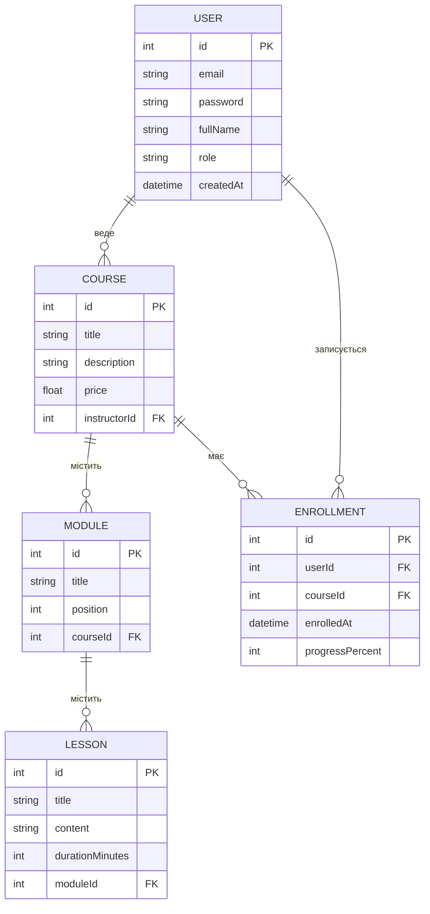

# Лабораторні роботи (Express + TypeScript + Prisma)

Дисципліна «Технологія розробки Інтернет-застосунків», ХНТУ. Студент: Тихонов Вадим.

ЛР1 — HTTP-сервер, ЛР2 — REST API на мок-даних, ЛР3 — PostgreSQL і Prisma.

## Предметна область: платформа онлайн-курсів

Викладачі ведуть курси, у курсів є модулі, а в модулів — уроки. Студенти записуються на курси.

Моделі: `User`, `Course`, `Module`, `Lesson`, `Enrollment`.

- `User` 1:N `Course` (викладач веде курси)
- `Course` 1:N `Module`, `Module` 1:N `Lesson`
- `User` N:M `Course` через `Enrollment` (там `enrolledAt` і `progressPercent`)

Ролі користувача: `USER` (студент), `MANAGER` (викладач), `ADMIN` (адмін платформи).



## Запуск

Потрібні Node.js і PostgreSQL.

```bash
npm install
copy .env.example .env
npx prisma migrate dev --name init
npx prisma db seed
npm run dev
```

Рядок підключення до БД лежить у `.env` (змінна `DATABASE_URL`).

## API (ЛР2)

Дані курсів і категорій поки що беруться з масивів у пам'яті.

| Метод | Шлях | Що робить |
|-------|------|-----------|
| GET | `/api/v1/health` | стан сервера |
| GET | `/api/v1/courses` | усі курси |
| GET | `/api/v1/courses/:id` | курс за id (404, якщо нема) |
| GET | `/api/v1/categories` | усі категорії |
| GET | `/api/v1/categories/:id` | категорія за id (404, якщо нема) |

Колекція для Postman: `postman_collection_milestone1.json`.

## Структура

```
prisma/
  schema.prisma
  seed.ts
  migrations/
src/
  app.ts
  server.ts
  routes/
  controllers/
  services/
  middlewares/
  utils/
```
